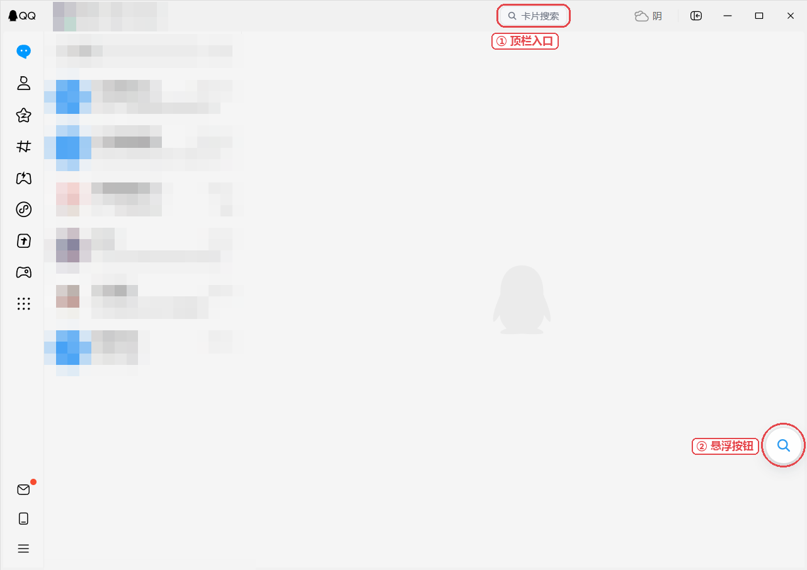
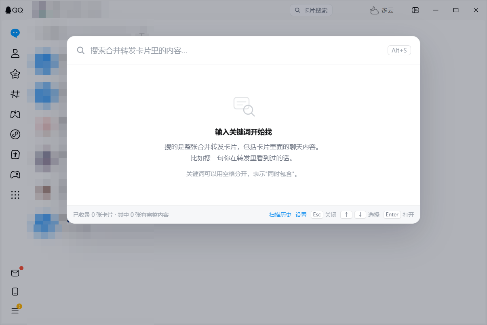
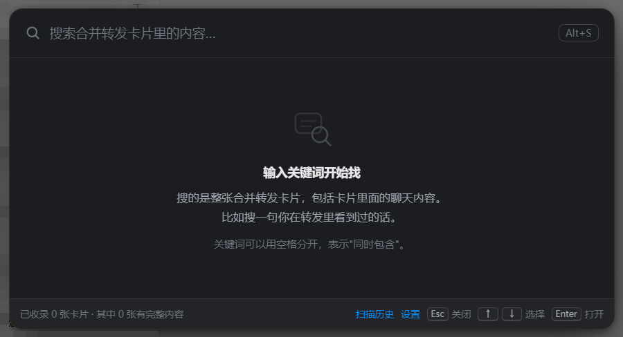

# 合并转发搜索（Forward Search）

> 给 QQ 加一个搜索框：输入一句话，直接找回那一整张合并转发卡片。

---

## 界面

### 入口在哪

装好之后，QQ 主面板上有两个入口，红框标出来的就是：



| ① 顶栏「卡片搜索」 | ② 右下角悬浮球 |
|---|---|
|  |  |

- 顶栏那个：跟着 QQ 顶栏走，窗口缩放时位置不变，永远在窗口按钮左边
- 悬浮球：按住能拖，拖到哪记到哪，下次启动还在那
- 两个都不点也行，`Alt + S` 一样能开

### 打开的弹窗

| 浅色 | 深色 |
|---|---|
|  |  |

默认跟随系统深浅色，不用自己选。

> 截图里的会话列表和昵称做了马赛克处理；弹窗是刚装好、还没收录卡片时的样子。

---

## 一、这东西解决什么问题

QQ 群里经常有人发「合并转发」的聊天记录卡片。QQ 自带的搜索有个很大的毛病：

**它只能搜到卡片外面那行摘要，搜不到卡片里面说了什么。**

结果就是——你明明记得某张转发里有人说过「第三季度有个异常值」，但怎么搜都搜不到，只能一个群一个群地往上翻。

这个插件补的就是这块：**按卡片里面的话，找到整张卡片。**

---

## 二、先看这四件事，能省你半小时

我不想你装完才发现"和想的不一样"，所以丑话说在前面。

### 1. 它做不到"装完立刻能搜全部历史"

这不是偷懒，是 QQ 的设计决定的。

合并转发卡片在 QQ 里只有两层：

| | 存在哪 | 能不能直接搜 |
|---|---|---|
| **外壳**（群名、时间、标题、摘要） | 你电脑上的数据库里 | 能，装上就能搜 |
| **里面那几十条聊天** | 腾讯的服务器上 | **不能**，得先拉回来 |

你每次点开卡片，QQ 都是现场去服务器拉的。所以想搜里面的内容，插件也必须先拉一次，没有别的办法。

**能做到的是：装完之后，内容会慢慢补齐，越用越全。**

### 2. 安装有门槛，做不到一键

因为 QQ 本身不允许第三方插件，得先装一个叫 **LiteLoaderQQNT** 的"插件加载器"，这一步需要手动改一个文件。

我尽量把步骤写细了，跟着做大概 5 分钟。但确实不是双击安装包那种。

### 3. 用之前请知道风险

LiteLoaderQQNT 官方 README 里写得很清楚：

> QQ 安全中心可能会将 LiteLoaderQQNT 当作"非法外挂工具"并下线您的设备，还有可能封禁您的账号。

这是**装加载器本身**就带着的风险，不是这个插件额外加的。但这个插件确实会调用 QQ 自己的消息接口去取数据，所以：

- **建议先拿小号试**，确认没问题再用主号
- 补全速度别调太快（设置里有），慢慢来
- 出问题立刻停用

**本项目仅供技术学习研究使用。**

### 4. 你的聊天正文会被存成明文

这一点得单独说，因为你可能没意识到：

为了能"离线搜索"，插件必须把卡片里的文字**复制一份到你自己硬盘上**——`LiteLoaderQQNT/data/forward-search/records.jsonl`，一行一条，包含发送人、时间、正文。

- **不上传任何服务器**，全程本地，断网也能搜
- 但它确实是明文的，任何能读你硬盘的程序都能读到
- 设置里有「打开目录」和「清空索引」，随时可以看、可以删
- 不想留：关掉「被动收录」，或直接把整个 `data/forward-search` 文件夹删掉

介意的话就别装了，这个取舍没法两头都要。

---

## 三、安装

### 第 1 步：装 LiteLoaderQQNT（如果已经装了，跳到第 2 步）

> 看不懂名词没关系，照着做就行。这一步只做一次。

**1.1 下载**

去 `https://github.com/LiteLoaderQQNT/LiteLoaderQQNT/releases/latest` 下载 `LiteLoaderQQNT.zip`，解压到一个**以后不会删的文件夹**，比如 `D:\LiteLoaderQQNT`。

> **为什么不能放临时目录**：QQ 启动时要按这个路径去加载，你把文件夹挪走或删掉，QQ 就打不开了。

**1.2 找到 QQ 的安装目录，先判断结构**

在 QQ 桌面图标上右键 → 打开文件所在位置。

看这个目录下**有没有 `versions` 文件夹**，这决定后面 `app` 在哪：

| 情况 | app 路径 |
|---|---|
| **有** `versions` 文件夹 | `QQ安装目录\versions\版本号\resources\app` |
| **没有** | `QQ安装目录\resources\app` |

结构长这样（版本号每个人不一样）：

```
QQ.exe
versions\
  └─ 9.9.31-49738\          ← 这个文件夹名字（版本号）每个人不一样
       └─ resources\
            └─ app\
                 ├─ package.json     ← 等下要改这个
                 └─ application.asar
```

**1.3 绕过 QQ 的文件校验（Windows 必须做）**

QQ 会检查自己的文件有没有被改过。不做这一步，改完 `package.json` 后 QQ 直接启动不了。

做法：拿到 `dbghelp.dll`，放进 **`QQ.exe` 所在的同一个文件夹**。

> ⚠️ **这里有个大坑**：`dbghelp.dll` 分 x64 和 ARM64 两个版本。你的**操作系统架构、QQ 架构、这个 dll** 三者必须一致。
> 绝大多数人的电脑是 x64，下 `dbghelp_x64.dll`；只有骁龙处理器的笔记本才是 ARM64。
> 放错了 QQ 会各种异常。

这个 dll 官方没有公开放在 Release 页，需要从 LiteLoaderQQNT 的 **Telegram 群**获取。拿不到的话，用下面 1.3 备选方案里的自动化工具，它会帮你处理。

**1.4 备选：用自动化工具（可跳过 1.5、1.6）**

社区有两个工具能自动完成"绕过校验 + 改入口 + 建启动脚本"，装完直接跳到 1.7 验证：

| 工具 | 说明 |
|---|---|
| `QQNTPatcher.exe` | 图形化补丁工具（作者 sysR@M），放在 LiteLoader 目录里运行，一键打补丁 |
| [LiteLoaderQQNT_Install](https://github.com/Mzdyl/LiteLoaderQQNT_Install) | Python 脚本，Windows / macOS / Linux 通用 |

> 工具也是人写的，QQ 大版本更新后可能失效。失效就回到手动流程。

**1.5 手动：写一个启动文件**

在 `resources\app` 里面新建一个文件夹，叫 `app_launcher`。
在里面新建一个文本文件，改名为 `LiteLoader.js`（注意：不是 `.txt`）。

用记事本打开它，只写一行——把反引号里的路径换成你第 1.1 步解压的位置：

```js
require(String.raw`D:\LiteLoaderQQNT`);
```

> 注意：是**文件夹**路径，不是某个 js 文件的路径。反引号别丢了（就是键盘左上角 Esc 下面那个键）。

**1.6 手动：改 QQ 的启动入口**

用记事本打开 `resources\app\package.json`，找到 `"main"` 这一行，改成：

```json
"main": "./app_launcher/LiteLoader.js"
```

**1.7 验证：加载器装好了吗**

启动 QQ，打开设置，看左侧是不是多了一个 **LiteLoaderQQNT** 的选项。

- 有 → 成功了，继续第 2 步
- 没有 → 按顺序检查：① `dbghelp.dll` 放对位置了吗（要跟 `QQ.exe` 同级）② `package.json` 的 `main` 改对了吗 ③ `LiteLoader.js` 里的路径正确吗

---

### 第 2 步：装这个插件

**2.1 下载**

去 Release 页面下载 `forward-search.zip`：

```
https://github.com/fushengzhenjun/LiteLoaderQQNT-Plugin-ForwardSearch/releases/latest
```

> **国内打不开 GitHub 的话**，用加速镜像（永远指向最新版）：
> ```
> https://gh-proxy.com/https://github.com/fushengzhenjun/LiteLoaderQQNT-Plugin-ForwardSearch/releases/latest/download/forward-search.zip
> ```
> 或者换 `ghfast.top` 前缀：
> ```
> https://ghfast.top/https://github.com/fushengzhenjun/LiteLoaderQQNT-Plugin-ForwardSearch/releases/latest/download/forward-search.zip
> ```
> 这些是第三方公益加速服务，不保证长期可用。能直连就用直连。

下载完**解压**，会得到一个 `forward-search` 文件夹。

**2.2 放进 plugins 目录**

把整个 `forward-search` 文件夹，复制到 LiteLoader 目录下的 `plugins` 文件夹里：

```
D:\LiteLoaderQQNT\
  └─ plugins\
       └─ forward-search\      ← 整个文件夹放这里
            ├─ manifest.json
            └─ src\
```

**2.3 重启 QQ**

完全退出 QQ（右下角托盘图标 → 退出，别只是关窗口），再重新打开。

**2.4 验证**

在 QQ 里按 **`Alt + S`**，或者点主面板顶部的「卡片搜索」按钮。

看到搜索框弹出来，就成了。

> 如果按了没反应：QQ 设置 → LiteLoaderQQNT → 插件列表，确认 `forward-search` 是启用状态。还不行就看文末「常见问题」。

---

### 第 3 步：让它先认识你的聊天（**别跳过**）

搜框能打开，但这时候**搜什么都是空的**——因为还没收录任何卡片。

做一件事：

1. 在 QQ 里**点开你常聊的那个群**（有合并转发卡片的群）
2. 打开搜索框，点右下角 **「扫描历史」**
3. 等它跑完（群里消息多的话要几分钟，可以随时暂停）

跑完之后，这个群的卡片就进索引了。之后**新收到的卡片会自动收录**，不用再手动扫。

> 换一个群搜，就再打开那个群扫一次。这是"被动收录"的代价，详见上面第 1 点。

---

## 四、怎么用

### 三种打开方式（不用快捷键也能用）

**方式一：悬浮按钮**（最省事）

主面板上有一个**圆形按钮**（放大镜图标），点一下就打开发搜索框。

- **能拖**：按住拖到顺手的位置，松手就记住，下次开 QQ 还在那儿
- 默认贴右下角，半透明，鼠标移上去才完全不透明
- 位置按比例存，换窗口大小、换分辨率都不会跑到屏幕外面
- 不想要它：设置里把「悬浮按钮」关掉即可

**方式二：顶栏小按钮**

QQ 主面板**右上角**、窗口最小化按钮左边，还有一个 `🔍 卡片搜索` 的小标签，同样点一下就开。

> 为什么放这个位置：QQ 顶栏右侧那一排（搜索图标 → 云盘 → 窗口按钮）之间只隔十几个像素，塞不下任何按钮，硬塞就会盖住 QQ 自己的图标。往左挪到空白区，既显眼又不挡任何东西。

**方式三：快捷键** `Alt + S`（可选）

想用就按，不想用完全可以无视它。快捷键在设置里是**"点一下然后按键"的录制方式**，不用手打字符串——手打很容易出现 `A+B` 这种无效值。

| 操作 | 作用 |
|---|---|
| `↑` `↓` | 上下选结果 |
| `Enter` | 打开选中的那张卡片 |
| `Esc` | 返回 / 关闭 |
| 空格 | 分隔多个关键词，表示"都要有"（比如 `方案 报价`） |

结果里每一条，对应的都是**一整张卡片**，不是零散的单条消息。显示三项：群名称、发送时间、卡片标题。

### 打开之后

点一条结果，**直接就站在那张卡片上了**。

插件会切到对应会话，把那条消息拉出来、滚到眼前，画一个蓝圈。不管是昨天还是半个月前的，
都是一步到位——实测从当前会话跳到 18 天前的卡片，0.3 秒。

- 卡片就在原会话里：切过去，圈出来
- 卡片在很久以前：QQ 自己补加载历史，你不用翻
- 目标消息真的被撤回/删除了：会说"找不到这条消息了"，不会让你白翻几十屏

图片、文件、表情这些插件读不到的东西，直接在 QQ 原界面里看。详情页上方两个按钮：

- **在聊天里定位这条**：同样一步送过去
- **打开原卡片**：传送过去之后自动替你点开，弹出 QQ 原生的"聊天记录"窗口，图片文件都在里面

> 怎么做到的：在 QQ 前端里找到了自己的"跳到某条消息"入口（`$MsgList` / `msgAction.jumpToAioMessage`），
> 走它比模拟滚轮可靠得多。这条路依赖 QQ 前端内部结构，所以留了降级：
> 万一哪天 QQ 改版拿不到，会自动退回"切会话 + 帮你翻页"的老办法。

> 上一版的"陪你翻"：QQ 9.9 的消息区是虚拟列表，只认真实滚轮，
> 脚本改 `scrollTop`、派发 `wheel` 都推不动（真机实测）。那条路现在只作为兜底保留。

### 第一次打开会看到一个说明页

它会问你选哪种模式，选完随时能改：

- **仅本地模式**（默认推荐先用这个）
  完全不联网。你打开过的卡片、别人发来时被动存下来的内容，都能搜到。**零风险增量。**
- **内容补全模式**
  打开之后，插件会用 QQ 自己的接口，把历史卡片的内容一条条补回来。覆盖更全，但会有请求。

### 「扫描历史」是干嘛的

弹窗右下角有个「扫描历史」。它会把你各个会话的聊天记录翻一遍，把里面的合并转发卡片都收进索引。

> 第一次点它会问你要不要打开「内容补全模式」——**点确定就行**。
> 那是"允许插件主动去读历史消息"的开关，只影响本插件，不会改 QQ 的任何设置。

> **重要前提**：只能读到 QQ **本地缓存过**的会话，也就是你打开过的那些聊天。
> 从没打开过的群，QQ 本地没有消息，接口会返回空列表——不是插件坏了，是服务端不下发。
> 所以想收某个群的历史，先在 QQ 里把那个群点开看几眼，再点「扫描历史」。
> 扫一次会把**所有已缓存的会话**一起过，不用逐个群去点。

**这是请求量最大的操作**，因为要逐页翻聊天记录。建议：
- 空闲的时候再跑
- 跑起来之后随时可以点它暂停
- 关了 QQ 下次还能接着补（没补完的会留在队列里）

---

## 五、设置

路径：QQ 左下角 ⚙ → 设置 → LiteLoaderQQNT → 合并转发搜索

| 选项 | 说明 |
|---|---|
| **主题** | `跟随系统`（默认）/ 浅色 / 深色。跟随系统时会实时跟着 Windows 深浅色切换，不用重启。 |
| **悬浮按钮** | 主面板上那个圆形按钮，关掉就只剩顶栏小标签和快捷键。 |
| **快捷键** | 点一下按钮，然后直接按组合键（如 `Ctrl+Shift+F`）。按 `Esc` 取消录制。改完重启 QQ 生效。 |
| **内容补全模式** | 关掉 = 纯本地，一个网络请求都不发。担心风险就一直关着。 |
| **被动收录** | 别人发卡片、你点开卡片时顺手存一份。不发额外请求，建议开着。 |
| **补全速度** | 两次请求之间的等待毫秒数。默认 1600。**想更稳就调大**，比如 3000。 |
| **打开目录** | 打开数据文件夹，看看存了啥 |
| **清空索引** | 删除插件存的全部记录（不影响 QQ 自己的聊天记录） |

---

## 六、常见问题

**Q：按了 Alt+S 没反应？**
先去设置里确认插件是启用的。如果启用了还没反应，可能是快捷键被别的软件占了，去设置里改成 `Ctrl+Shift+F` 试试，改完**重启 QQ**。

**Q：弹窗出来了，但什么都搜不到？**
两种可能：① 索引还是空的，去跑一次「扫描历史」；② 你想要的内容在卡片内部，但还没补全。先把内容补全模式打开。

**Q：搜到了卡片，但点开显示"内容还没补全"？**
正常。补全队列还没轮到它。点一下详情里的「开始补全」，或者等它自己跑。

**Q：会不会让 QQ 变卡？**
搜索是纯内存里跑字符串匹配，几万张卡片大约几十毫秒，感知不到。补全队列是单线程、带间隔地慢慢跑，也不会拖慢界面。

**Q：我的聊天记录会被传到别的地方吗？**
不会。所有数据只存在你自己电脑上的一个文件里（设置里「打开目录」能看到）。插件没有任何上传逻辑。

**Q：QQ 更新之后插件坏了？**
有可能。QQ 内部接口每次大版本都可能变。如果你更新 QQ 后发现"内容补全"不好使了，但基础搜索还在——这是设计好的降级，不是崩了。等插件更新即可。

**Q：怎么彻底卸载？**
删掉 `plugins\forward-search` 文件夹，再删掉设置里「打开目录」那个数据文件夹。两步都要做，否则索引文件会留着。

---

## 七、文件说明（想改代码的看这里）

```
forward-search/
├─ manifest.json          插件身份证，告诉 LiteLoader 怎么加载
├─ README.md              你正在看的这份
└─ src/
   ├─ main.js             主进程：管配置、管索引文件、做搜索
   ├─ preload.js          桥接层：借 QQ 自己的通信通道，被动收录卡片
   ├─ renderer.js         界面层：弹窗、搜索、详情、设置页
   ├─ style.css           样式，跟着 QQ 深浅色自动换
   └─ core/
      ├─ record.js        卡片识别与解析（最核心的一块）
      └─ store.js         本地存储 + 全文检索
```

三个进程各管一摊，这是 Electron 的规矩：

- **main.js** 在 QQ 主进程跑，只有它能读写文件
- **preload.js** 在中间，既能读写文件又能跟 QQ 通信
- **renderer.js** 在界面层跑，只管画界面

### 想改搜索行为？

看 `src/core/store.js` 里的 `search()`。目前是"逐条字符串包含"，中文按原样匹配，不做分词。这个选择是为了省内存——倒排索引在中文下会膨胀得很快。

### 想让它支持更多消息类型？

看 `src/core/record.js` 的 `cardFromMessage()`。判断合并转发的关键是 ark 消息里带 `com.tencent.multimsg`。

---

## 八、已知限制（诚实版）

1. **跳转依赖 QQ 前端内部结构。** 现在走的是 QQ 自己的"跳到某条消息"入口，一步到位；
   但它不是公开接口，QQ 改版后可能失效（失效时自动退回"切会话 + 帮你翻页"的老办法，不会直接坏掉）。
   另外，消息如果已经被撤回或删除，插件会直说"找不到"，这时确实没法定位。

2. **完整正文未必拿得到。** 在 QQ 9.9.31 上实测，`getMultiMsg` 会被服务端拒绝（`server return failed`）或返回空列表，
   所以能搜到的是卡片**预览里的前几行**（就是卡片封面显示的那几句，通常 3~6 行）。
   预览里那几句已经是卡片内部的原文，所以"记得里面说过某句话"多数能命中；但很靠后的内容可能搜不到。

3. **群名可能显示成 ID。** 仅本地模式下不联网，如果某张卡片收录时没带上群名，就只能显示会话 ID。

4. **嵌套转发只展开一层。** 卡片里如果还套着卡片，内层那个不会再展开。

5. **首次扫描会比较久。** 群多、消息多的话可能十几分钟。慢慢跑就行，可以随时暂停。

---

## 九、这份代码验证到了什么程度

写清楚这一节，是为了让你知道哪些地方可以放心、哪些地方需要你自己试。

**已经模拟真机环境跑过的部分**（用 LiteLoader 官方源码 + 模拟的 Electron 环境测的，不是空口说）：

| 测试项 | 结果 |
|---|---|
| 用 LiteLoader 自己的 `loader.js` 加载本插件 | 通过，`injects` 三个脚本路径都正确解析 |
| 主进程脚本 `require` 后注册钩子 | 通过，导出的 `onBrowserWindowCreated` 是 LiteLoader 真会调用的名字 |
| 10 个 IPC 接口注册 | 全部通过 |
| 配置与索引落盘 | 通过（并因此修掉一个真实的目录不存在 bug） |
| 快捷键唤起 → 输入 → 搜到结果 → 点开详情 | 通过，界面元素和文字都对 |
| `nativeCall` 发出的 IPC 报文格式 | 通过，通道名、字段名、参数包装都符合预期 |
| 接口超时降级 | 通过，1.5 秒后返回空值，不卡界面、不抛异常 |

**没有条件验证的部分**，需要你实际装到 QQ 里才知道：

1. 那三个 QQ 内部接口（`getMultiMsg` / `getMsgsIncludeSelf` / `getRecentContactList`）在**你这个 QQ 版本**上参数对不对。这是唯一真正不确定的地方。
2. 快捷键在 QQ 已占用 `Alt+S` 时会不会冲突。
3. 主题跟随在你当前 QQ 皮肤下的实际观感。

如果第 1 条失败，表现是：搜索和界面都正常，但内容始终显示"未补全"。这时候把 QQ 日志里带 `[forward-search]` 的行发出来，改参数映射表就行，不用重写。

---

## 十、真机实测记录（QQ 9.9.31 / Windows）

这一节不是推演，是把插件真正装进 QQ 之后得到的结论。踩过的坑都记在这里，你装的时候能少走弯路。

### 1. 文件校验补丁要打 `QQNT.dll`，不是 `QQ.exe`

网上很多教程含糊地说"选中 QQ 文件"，实测结果很明确：

| 目标文件 | 结果 |
|---|---|
| `QQ/QQ.exe` | `[-] Sig not Found!`（认不出，打不上） |
| `QQ/versions/9.9.31-49738/QQNT.dll` | `[+] Found at 0x004D2037` → `[+] Patched!` |

注意这个 Patcher 会先把你选的**原文件改名成 `.bak`**，再写新文件。如果目录里已经存在同名 `.bak`，它会报「拒绝访问」什么都不写。所以打之前先确认没有旧的 `.bak`。

### 2. preload 在沙箱里，只能 `require('electron')`

这是本次最大的坑，也是原版代码跑不起来的原因。

QQ 的 preload 环境是沙箱化的：`fs`、`path`、以及**本地模块**（`require('./core/record.js')`）全部不可用。一旦 require 它们，整个 preload 直接抛异常，`window.forwardSearch` 就永远挂不上去——表现就是搜索框能开，但什么都不显示。

坏下去的时候报错长这样，很难猜：

```
[Preload] [forward-search]:  [object DOMException]
[forward-search] 没有拿到桥接接口，插件功能不可用（请检查 preload 是否加载）
```

所以本插件的结构是：**preload 只做转发，不读文件也不解析**。样式表由主进程代读，消息解析也在主进程做。这个设计现在是为了绕开沙箱，但顺带也更安全——preload 越薄越好。

### 3. 主题判定的坑（已修）

装上之后第一眼看到的是：QQ 明明是浅色界面，弹窗却是黑的。

原因不在主题监听，而在取值方式：QQ 的 `body` 背景是 `rgba(0,0,0,0)`（全透明），旧代码把 rgb 三个数取出来算亮度，得到的是纯黑，就判定成深色了。而真正的底色画在 `body` 的子容器上（`#app` 那一层），往上找是找不到的。

修法是两层兜底：

1. 从 `body` 往上找，先看 `alpha`，透明就跳过继续往上；
2. 如果整条祖先链都透明，就用左上角那个点（`elementFromPoint`）所在元素往上找——等于问"这块地方实际是什么颜色"，同时排掉弹窗自己的遮罩，避免把自己算进去。

顺带加了一条 `主题切换为 dark/light` 的日志，主题判断出问题时可以直接看。

**这个 bug 只有真机才能发现**，jsdom 里默认背景是空的，永远走不到那条分支。现在补了两个场景的测试（`t5-theme.js`：body 透明 + 容器白 / 容器深灰），两种情况都通过。

### 4. 入口按钮的位置，是量出来的

一开始想贴在窗口按钮左边（`right: 176px`），真机一看，正好压在 QQ 顶栏自己的图标上。

于是把顶栏的每个图标坐标都打出来量了一遍：

```
全局搜索图标 ≈ 664  →  云盘图标 ≈ 720  →  窗口按钮 792 起
```

中间只剩十来个像素，塞不下任何按钮。最后放在搜索图标左边的空白区（`right: 306px`），既在视线范围内，又不会挡任何东西。

按钮用 `position: fixed` 挂在 `body` 上，而不是插进 QQ 的 Vue 顶栏——顶栏会随状态重渲染，插进去的节点随时会被抹掉。另外每 3 秒检查一次，万一被抹掉就补回来。

### 5. 按钮配色跟着 QQ 走，面板配色跟着设置走

这两件事得分开：

- **弹窗**用你在设置里选的主题（跟随系统 / 浅色 / 深色）；
- **入口按钮**贴在 QQ 自己的顶栏上，所以永远跟着 QQ 当前底色。否则在浅色 QQ + 深色弹窗这种组合下，会出现"浅色顶栏上钉着一个深色块"的怪样子。

### 6. 快捷键的两起事故（已修）

**事故一：在设置里改快捷键，一边打字一边弹窗。**

设置页原先是个普通输入框，而全局 `keydown` 监听挂在 `document` 上——用户按什么键，它都当快捷键处理。日志里留下了证据：

```
[renderer] 快捷键命中 key=B alt=false open=false
```

修法：`keydown` 里先看事件源，只要是 `input` / `textarea` / `contenteditable` 就直接让路。输入法、聊天框、设置页都不再被劫持。

**事故二：手打出无效值，快捷键变成"按什么都弹"。**

用户把快捷键改成了 `A+B`。解析时 `B` 被当成主键、`A` 被当成修饰键，两者都不成立，最终退化成"单按 B 就触发"。空字符串更糟——之前会返回 `key: ''`，等于任意按键都可能命中。

修了三层：

1. `parseHotkey()` 遇到空值、只有修饰键、或未知修饰键（`A+B`）一律返回 `disabled`，主流程直接跳过；
2. 主进程 `normalizeHotkey()` 在**读配置**和**存配置**两处挡一道，发现非法值就回退到 `Alt+S` 并回写文件（真机上那次 `A+B` 就是这么自动修好的）；
3. 设置页改成**录制式**：点一下按钮，然后直接按组合键，Esc 取消。人不会再手打出废值。

这三条都有测试兜底：`_llverify/t6-hotkey.js`。

### 7. 截图验证踩的坑：DPI 缩放

用 `PrintWindow` 截 QQ 窗口时，第一次截出来的图里，面板右边被切掉了、底部提示也不全，看着像布局炸了。

实际是**截图进程没有声明 DPI 感知**：系统按 125% 缩放返回了坐标和位图，1205px 宽的窗口被当成 964px 截了。声明 `SetProcessDpiAwareness(2)` 之后一切正常，量出来的 DOM 尺寸（面板 700 宽、居中、底部 698/698 无溢出）才和截图对得上。

教训：**先量数，再看图**。只看截图很容易把工具的问题当成代码的问题，白改一通。

### 8. 实测通过的环节

| 环节 | 结果 |
|---|---|
| `QQNT.dll` 打补丁后 QQ 正常启动 | 通过，日志里不再出现 `error code v2:-8` |
| LiteLoader 加载插件 | 通过，`[forward-search] 已载入 N 条卡片记录` |
| preload 暴露桥接接口 | 通过，报错数从 12 降到 0 |
| 样式表加载 | 通过，界面不再是裸 HTML |
| 快捷键注册 | 通过，`插件已就绪，快捷键 Alt+S` |
| 主面板入口按钮 | 通过，`入口按钮已挂载 rect=573,8 85x24`，位置不压任何 QQ 元素 |
| 弹窗渲染（浅色 / 深色） | 通过，底部提示不截断，`Alt+S` 标签正常 |
| 入口按钮独立配色 | 通过，深色弹窗 + 浅色 QQ 顶栏时按钮仍是浅色 |
| 悬浮按钮 | 通过，可拖动并记住位置（日志：`位置已保存 x=0.912 y=0.730`） |
| 快捷键被输入框劫持 | 已修，`t6-hotkey.js` 覆盖 |

### 9. 还没验证的一环

**登录之后**才能验证的三件事：卡片能不能被正确收录、搜索能不能命中、跳转能不能定位。这三件都需要你的账号登录，我没法替你做。

### 10. 出问题看哪里

插件在数据目录里留了一份 `debug.log`（`<LiteLoader 目录>/data/forward-search/debug.log`），记录的是：

- 每个窗口的渲染层有没有正常加载、桥接有没有挂上
- 读到的配置（主题 / 快捷键）
- 入口按钮挂载位置
- 快捷键有没有真正命中（`快捷键命中 key=S alt=true`）

界面不弹、按钮不见、快捷键没反应，先看这个文件，基本能定位到是哪一环断了。

如果想看弹窗长什么样（比如远程帮别人排查），在 `config.json` 里把 `debugAutoOpen` 改成 `true`，启动后会自动弹一次；看完记得改回 `false`。

## 十一、写在最后

这个插件的存在前提是：**你愿意为自己的数据多花一点力气。**

它做的事情不复杂——就是把你本来就能看到、但搜不到的东西，变成能搜到的。

请只用它管理你自己的聊天记录，不要拿它去做任何违反 QQ 用户协议或者法律法规的事情。

代码是开源的，你可以自己审一遍 `src/` 下每个文件，确认它没有偷偷往外传东西。

---

## 想把它发出去？

打包、建仓库、传 Release、上架插件市场，以及**发布前必须处理的隐私问题**，都写在 [PUBLISHING.md](./PUBLISHING.md) 里了。代码部分不用再动，照着清单走即可。
